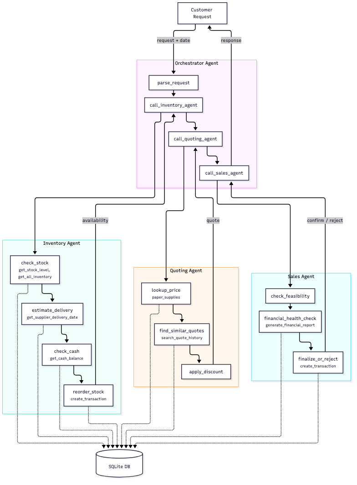

# Beaver's Choice Paper Company — Multi-Agent Order Processing System

A multi-agent system built with **pydantic-ai** that handles customer orders for a fictional paper supply company. The system parses free-text requests, manages inventory and reordering, applies bulk discounts, and makes order fulfillment decisions with clear customer-facing explanations.

## System Architecture



**4-Agent Design:**
- **Orchestrator Agent** — Parses customer text, delegates to workers, composes final responses
- **Inventory Agent** — Checks stock levels, handles reordering decisions
- **Quoting Agent** — Applies bulk discount tiers, generates pricing explanations
- **Sales Agent** — Final fulfillment gate, ensures financial viability

## Quick Start

### Setup
```bash
python -m venv .venv
source .venv/bin/activate
pip install -r requirements.txt
```

### Configuration
Create a `.env` file with your API keys:
```env
OPENAI_API_KEY=sk-...
OPENAI_MODEL=gpt-4o-mini
```

### Run Tests
```bash
python project_starter.py
```

Generates `test_results.csv` with order outcomes.

## Input Example

**Customer Request (free text):**
```
Hi, I need 500 sheets of recycled paper and 250 sheets of A4 paper for my reception 
on April 5th. Can you process this?
```

**System Output:**
```
Thank you for your order! For your reception, you have selected the following paper supplies:

- 500 sheets of Recycled paper
- 250 sheets of A4 paper

Your subtotal comes to $52.50. Since this is a bulk order, we are pleased to offer you a 
10% discount, bringing your total to $47.25. We appreciate your business and hope your 
event is a great success!
```

## Dataset Preview

Sample results from 20 test requests (10 fulfilled, 10 rejected):

| Request | Date | Status | Cash Balance | Inventory Value | Order Summary |
|---------|------|--------|--------------|-----------------|---------------|
| 1 | 2025-04-01 | ✅ Fulfilled | $45,121.45 | $4,875.30 | 200 glossy + 100 cardstock + 100 colored paper (5% discount: $61.75) |
| 4 | 2025-04-05 | ✅ Fulfilled | $45,128.70 | $4,862.80 | 500 recycled + 250 A4 paper (10% discount: $47.25) |
| 7 | 2025-04-07 | ✅ Fulfilled | $45,524.65 | $4,392.85 | 500 glossy + 300 poster + 200 cardstock (15% discount: $365.50) |
| 2 | 2025-04-03 | ❌ Rejected | $45,121.45 | $4,875.30 | Item not in catalog: balloons, streamers |
| 6 | 2025-04-06 | ❌ Rejected | $45,182.50 | $4,799.50 | Insufficient stock of cardstock; item not carried (printer paper) |
| 13 | 2025-04-08 | ❌ Rejected | $44,955.00 | $4,541.75 | Delivery deadline: requested April 10, available April 12 |

**Bulk Discount Tiers:**
- ≥1,000 units → 15% off
- ≥500 units → 10% off
- ≥100 units → 5% off
- <100 units → no discount

## Key Features

- **Deterministic pricing** — Discount tier applied consistently; numeric values frozen after LLM explanation
- **Atomic fulfillment** — Entire order accepted or rejected; no partial orders
- **Clear rejection reasons** — Specific item + cause (stock, delivery date, not in catalog)
- **Inventory reordering** — Inventory Agent restocks proactively when affordable
- **LangSmith tracing** — Optional observability via OpenTelemetry (enable with `LANGSMITH_API_KEY` in `.env`)

## Project Files

- `project_starter.py` — Main implementation (all 4 agents + tools)
- `workflow_diagram.mmd` — Mermaid diagram source
- `workflow_diagram.png` — Visual workflow
- `test_results.csv` — Full results from 20 test requests
- `REPORT.md` — Detailed architecture & design decisions
- `requirements.txt` — Python dependencies

## Evaluation Results

**20 test requests:**
- 10 fulfilled (50%)
- 10 rejected with specific reasons (50%)
- Cash balance changed on 18/20 requests (inventory reorders even on rejected orders)

See `test_results.csv` for full details and `REPORT.md` for design rationale.
